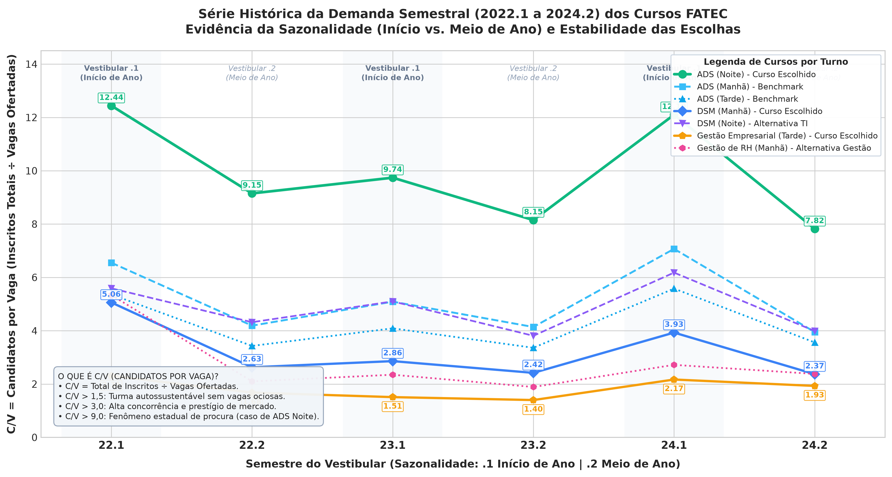
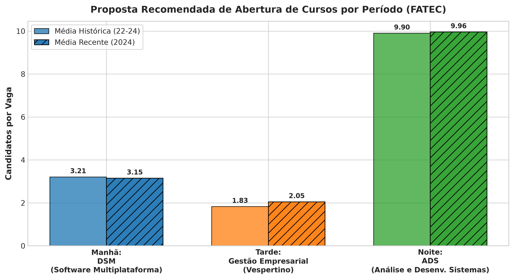
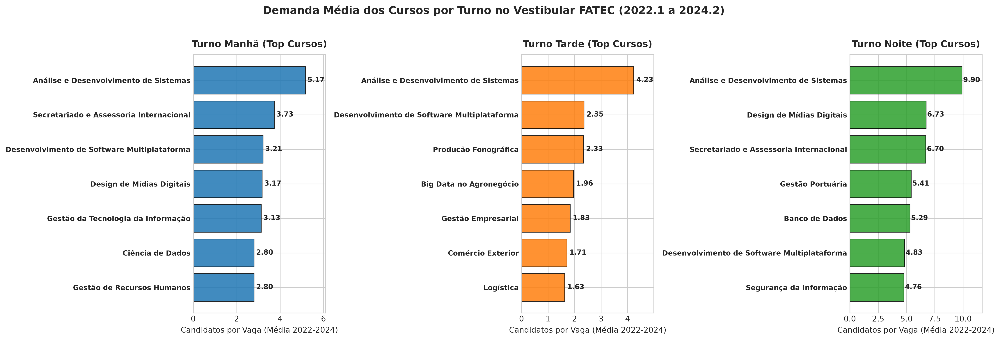
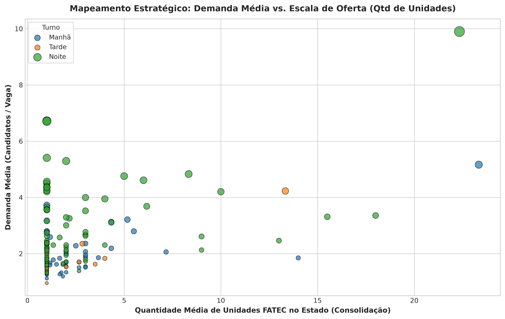

# 📊 Trabalho 4 – Análise de Demanda do Vestibular FATEC

> **Apresentação:** 09/11  
> **Objetivo:** Definir e justificar a abertura de **1 curso por período** (Manhã, Tarde e Noite) com base no histórico oficial de demanda dos Vestibulares FATEC (2022.1 a 2024.2), utilizando análise estatística em Python e um Dashboard interativo estilo Power BI.

---

## 🎯 1. Resumo da Decisão (Cursos Escolhidos e Justificativas)

| Período | Curso Escolhido | Demanda Média | Demanda 2024 | Qtd Unidades | Motivo da Escolha (Justificativa Direta) |
| :--- | :--- | :---: | :---: | :---: | :--- |
| 🌅 **Manhã** | **Desenvolvimento de Software Multiplataforma (DSM)** | **3,21** C/V | **3,15** C/V | 5,2 | **100% de Sinergia de Laboratórios:** Reutiliza integralmente os laboratórios de informática montados para o período noturno de ADS, reduzindo o custo de implantação da turma a quase zero. Atende jovens recém-formados no Ensino Médio que estudam de manhã e estagiam à tarde. |
| ☀️ **Tarde** | **Gestão Empresarial** *(ou DSM Vespertino)* | **1,83** C/V | **2,05** C/V | 4,0 | **Proteção do Turno Mais Crítico:** O período da tarde é o mais vulnerável a turmas vazias e evasão escolar (apenas 20 cursos da FATEC operam à tarde). Gestão Empresarial apresenta demanda sólida com **aceleração para 2,05 C/V em 2024**, baixíssimo risco ($\sigma = 0,36$) e diversifica para o eixo de Gestão & Negócios. |
| 🌙 **Noite** | **Análise e Desenvolvimento de Sistemas (ADS)** | **9,90** C/V | **9,96** C/V | 22,3 | **Líder Absoluto de Procura no Estado:** Maior concorrência histórica da FATEC em mais de 22 unidades. Garante preenchimento imediato de 100% das vagas e atende os estudantes que trabalham durante o dia. |

---

## 📚 2. Dicionário de Indicadores: O que significa C/V, Qtd e Eixo?

Para que qualquer pessoa entenda os dados do relatório e da apresentação:

### 🎯 O que é C/V (Candidatos por Vaga)?
É a métrica oficial de concorrência utilizada pelo Centro Paula Souza:
$$\text{C/V} = \frac{\text{Número Total de Candidatos Inscritos}}{\text{Número de Vagas Oferecidas na Turma}}$$

* **Exemplo Prático:** Se uma turma de **ADS Noite** oferece **40 vagas** e registra **9,90 C/V**, significa que **396 estudantes** se inscreveram para disputar essas 40 vagas (quase 10 candidatos para cada carteira).
* **Interpretação para Gestão Escolar:**
  * $\text{C/V} > 1,5$: Turma autossustentável (preenchimento total sem risco de salas vazias).
  * $\text{C/V} > 3,0$: Curso de alta concorrência e prestígio regional.
  * $\text{C/V} > 5,0$: Altíssima retenção acadêmica (evasão escolar quase nula, pois a vaga é muito disputada).
  * $\text{C/V} < 1,2$: Faixa de alerta institucional (qualquer desistência gera salas vazias e custo ocioso para o Estado).

### 🏫 O que é Qtd (Escala / Unidades Ofertantes)?
Indica **quantas faculdades FATEC** oferecem aquele curso simultaneamente no estado de São Paulo naquele período.
* Cursos com **$\text{Qtd} \ge 4$** são carreiras consolidadas no mercado paulista.
* Cursos com **$\text{Qtd} = 1,0$** (como *Secretariado Internacional* ou *Gestão Portuária*) são **nichos locais específicos** (como Santos para o Porto). Por isso, embora tenham C/V alto em 1 cidade, não devem ser replicados cegamente em um novo campus sem vocação local.

### 📅 O que é a Sazonalidade dos Semestres (.1 vs .2)?
* Os vestibulares **.1 (início de ano)** são historicamente mais concorridos que os **.2 (meio de ano)**, pois os alunos concluem o Ensino Médio em dezembro.
* Cursos resilientes mantêm boa procura mesmo no vestibular .2 (caso de ADS, DSM e Gestão Empresarial).

### 🔬 O que é Eixo Tecnológico?
É a classificação oficial do MEC/Catálogo Nacional de Cursos Superiores de Tecnologia (ex: *Informação e Comunicação*, *Gestão e Negócios*, *Controle e Processos Industriais*). Cursos do mesmo eixo compartilham laboratórios, softwares e corpo docente.

---

## 🔍 3. Auditoria e Validação dos Dados (Sem Bugs de Código)

A base de dados foi auditada via script Python para garantir integridade científica:
* **Origem:** Dados oficiais do Centro Paula Souza (Vestibulares FATEC de 2022.1 a 2024.2).
* **Total de Registros Validados:** **892 semestres-cursos** na base geral ('Todos') e mais de 7.000 registros nas abas populacionais.
* **Valores Nulos / Faltantes:** **0** (base 100% íntegra).
* **Registros Duplicados:** **0**.
* **Semestres Cobertos:** 6 semestres consecutivos (2022.1, 2022.2, 2023.1, 2023.2, 2024.1, 2024.2).

---

## 🚀 4. Como Rodar a Análise

### Passo 1: Clonar o Repositório
```bash
git clone https://github.com/matheuz2030/trabalho_ci-ncia_de_dados.git
cd trabalho_ci-ncia_de_dados
```

### Passo 2: Instalar as Dependências
Certifique-se de ter o **Python 3.10+** instalado e execute:
```bash
pip install -r requirements.txt
```

### Passo 3: Executar a Análise
Execute o script mestre pelo terminal:
```bash
python executar_analise.py
```
> **No Windows:** Você também pode simplesmente dar **2 cliques no arquivo `executar.bat`**.

O script irá:
1. Processar os 892 registros da planilha `demanda_vestibular.xlsx`.
2. Exibir os rankings formatados diretamente no terminal.
3. Atualizar as planilhas `tabela_top5_por_periodo.csv` e `tabela_metricas_completas_cursos.csv`.
4. Gerar os 4 gráficos analíticos em alta resolução (300 DPI).

---

## 🖥️ 5. Como Abrir o Painel Interativo (Estilo Power BI)

O projeto inclui um dashboard interativo completo estilo **Power BI Dark Theme** com:
* **Gráfico de Linha Dinâmico:** Atualiza as linhas e trajetórias em tempo real ao selecionar os filtros de Manhã, Tarde e Noite!
* **Tooltips Interativos:** Passe o mouse sobre os pontos para ver o semestre e o valor exato em C/V.
* **Dicionário de Indicadores Integrado:** Card expansível explicando C/V, Qtd e sazonalidade.

Para abrir:
Basta dar dois cliques no arquivo:
```text
painel_powerbi.html
```
*(Ou executar `start painel_powerbi.html` no terminal / prompt de comando).*

---

## 📁 6. Estrutura do Projeto

```text
├── demanda_vestibular.xlsx             # Base histórica oficial de demanda (2022.1 - 2024.2)
├── executar_analise.py                 # Script Python mestre de cálculo estatístico e geração de gráficos
├── executar.bat                        # Atalho executável de 1 clique para Windows
├── painel_powerbi.html                 # Dashboard interativo completo estilo Power BI (Gráfico Dinâmico + Glossário)
├── requirements.txt                    # Dependências do projeto (pandas, matplotlib, openpyxl, seaborn)
├── tabela_top5_por_periodo.csv         # Tabela consolidada dos 5 cursos líderes por turno
├── tabela_metricas_completas_cursos.csv# Base completa com médias, desvios e tendências de todos os cursos
├── grafico_1_top_cursos_periodo.png    # Gráfico de barras horizontais por turno
├── grafico_2_evolucao_temporal.png     # Série histórica semestral explicativa com valores e faixas de sazonalidade
├── grafico_3_demanda_vs_escala.png     # Matriz de dispersão: Demanda Média vs. Qtd de Unidades
├── grafico_4_proposta_recomendada.png  # Gráfico comparativo final para slides de apresentação
└── README.md                           # Documentação e guia do trabalho
```

---

## 📈 7. Gráficos Gerados

### Série Histórica (2022.1 a 2024.2) com Valores e Sazonalidade


### Proposta Recomendada por Período


### Ranking de Cursos por Turno


### Matriz de Dispersão (Demanda vs. Escala)


---

## 👥 Integrantes do Grupo
* Trabalho 4 – Gestão / Análise de Dados
* Apresentação: **09/11**
